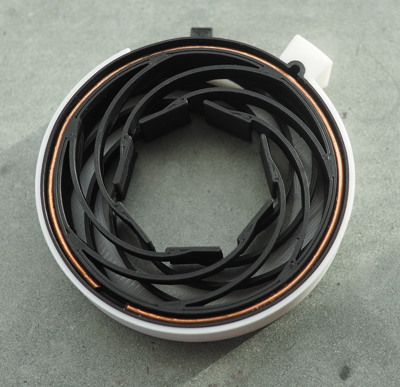
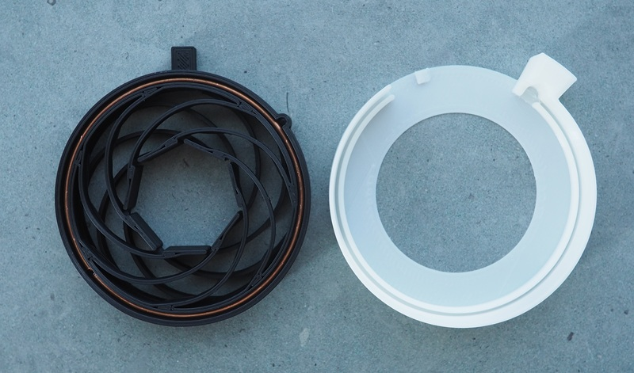

Improved version of the stargate electrode, now longer lasting, easier to insert and with more flex.

Not shown in image: clip-on spacer to restrict maximum opening angle.
I found this was necessary to keep good contact during clenching. 

# Materials

* 1.7mm diameter solid metal wire. I salvaged some from 2.5mm^2 16A wire.
* 2mm Banana plug.
* Inner ring: Protopasta conductive PLA or similar. Designed for the stiffness of PLA.
* Outer ring: filament of your choice.
* Spacer: filament of your choice.

# Printing

Designed for 0.6mm line width.

No supports. The model comes with its own break-away supports.
